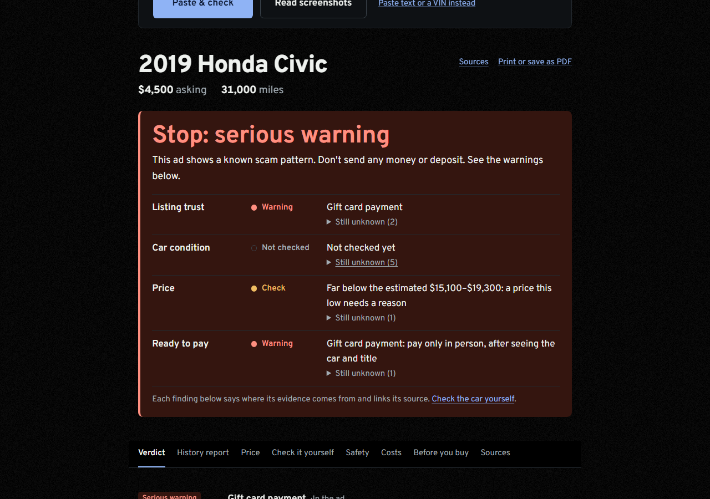
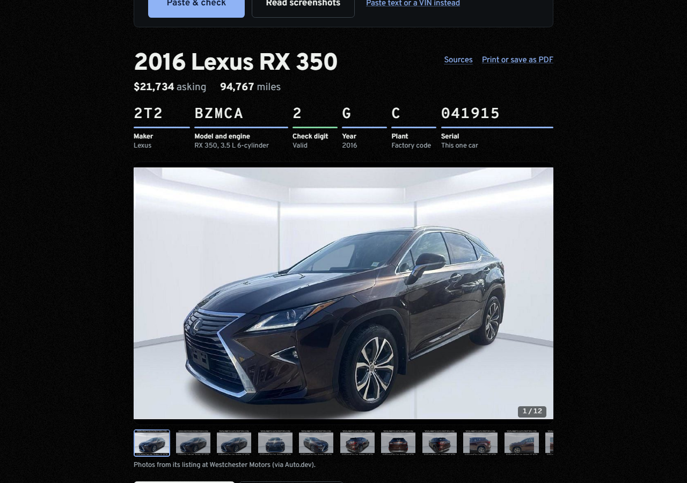
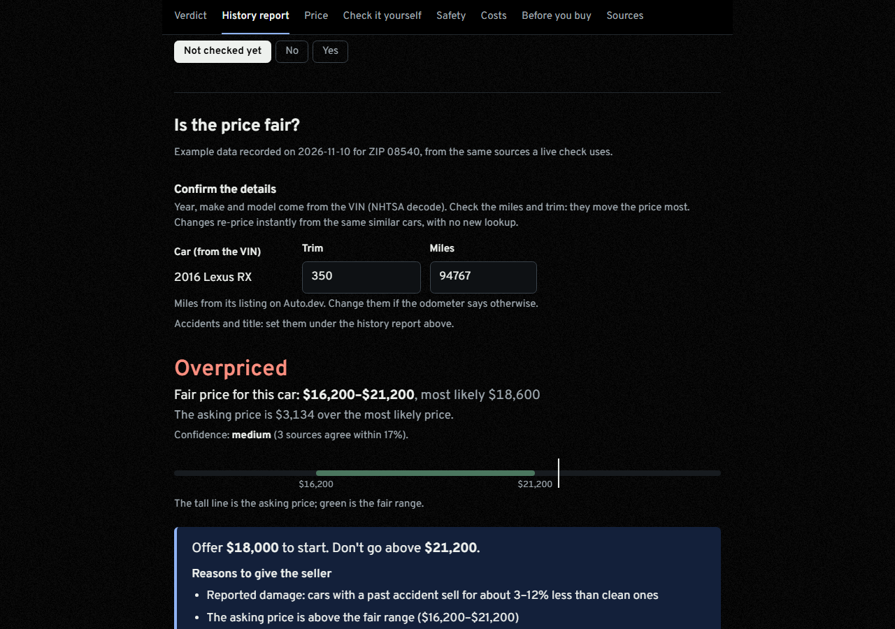
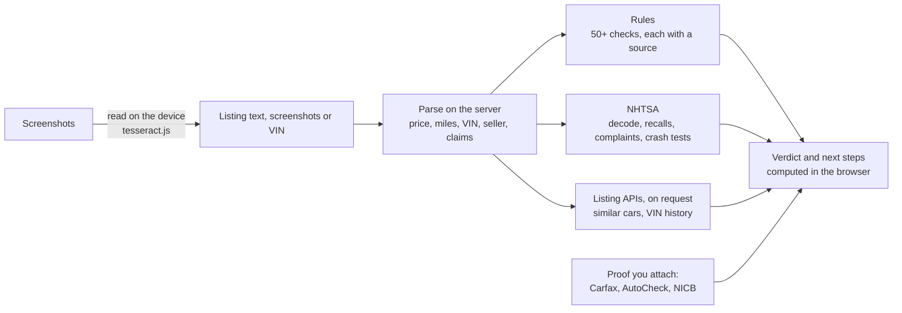

# VinVerdict

**A free second opinion before you buy a used car.** Paste a Facebook Marketplace, Craigslist or dealer listing (or just a VIN) and VinVerdict tells you whether the ad shows scam warning signs, what the car is really worth near you, what's known to go wrong with that model year, and exactly what to check next. Every fact links to the record it came from.

**Try it:** https://vinverdict.vercel.app (no sign-up)


---

## Contents

- [What it does](#what-it-does)
- [How to use it](#how-to-use-it)
- [What it won't do](#what-it-wont-do)
- [Where the data comes from](#where-the-data-comes-from)
- [How it works](#how-it-works)
- [Accuracy](#accuracy)
- [Security and privacy](#security-and-privacy)
- [Run it yourself](#run-it-yourself)
- [Help improve it](#help-improve-it)

---

## What it does

| You want to know… | VinVerdict checks… |
| --- | --- |
| **Should I go see it?** | One next step (Stop, Verify before going further, Worth investigating, or Not enough information) and four checks behind it: can you trust the listing, what shape is the car in, is the price right, is it safe to pay. Each shows what's still unknown. |
| **Is this ad a scam?** | 50+ checks on the ad's own words and data, each tied to FBI, FTC or NICB guidance: gift-card or payment-app deposits, "I'm deployed, it's at a shipping company", a price far below similar cars, a VIN that doesn't match the ad, a title not in the seller's name, and more. |
| **Is the VIN real, and is it this car?** | The check digit, then NHTSA's decoder, compared with the year, make, model and gearbox in the ad. |
| **Has this car been listed before?** | Past listings of the VIN that MarketCheck recorded since 2015: dates, prices, miles and sellers. It flags odometer drops, quick dealer resales and price cuts. |
| **Is the price fair here?** | Advertised prices of similar cars near your ZIP (listed now, or recently ended), each linked, adjusted for miles, seller type and reported damage. You get an opening offer and a walk-away price. |
| **What goes wrong with this model year?** | NHTSA recalls (including "don't drive" and "park outside" warnings), crash-test stars, owner complaints, and known issues backed by the maker's own service bulletins. |
| **What will it cost me?** | The out-the-door price with your state's tax and fees, plus fuel (EPA ratings) and upkeep per year. |
| **What should I check myself?** | Links to the free official checks (NHTSA recall lookup, NICB theft/salvage check, NMVTIS), with the VIN ready to copy. Attach a screenshot or paste a Carfax or AutoCheck report, and VinVerdict reads it, files it under the right check and updates the verdict. |



## How to use it

**On a computer**
1. Open the listing (Facebook Marketplace, Craigslist, Autotrader, Cars.com, a dealer's site…).
2. Press **Ctrl+A** then **Ctrl+C** (Mac: **Cmd+A**, **Cmd+C**) to copy the whole page.
3. Go to https://vinverdict.vercel.app, click the box, press **Ctrl+V**, then **Paste & check**.
4. Read the verdict, then open the tabs: **Price**, **Check it yourself**, **Safety**, **Costs**, **Before you buy**.

Tip: drag the **bookmark button** on the home page to your bookmarks bar. On any listing page, click it to send that page to VinVerdict in one step.

**On a phone** (apps like Facebook have no "select all")
1. Take screenshots of the listing: the title and price, the details, and the seller's description.
2. On VinVerdict, tap **Read screenshots** and pick them. They're read on your phone and never uploaded.

**Only have a VIN?** Paste the 17-character VIN. VinVerdict decodes it, looks for where it's listed now and before, and prices it.

**Selling instead of buying?** After a VIN lookup, choose **It's mine: what's it worth?** to see what it's worth to a private buyer or a dealer.






## What it won't do

These limits are deliberate. A tool that sounds sure when it isn't does more harm than one that says "not checked".

- **It never says a car is safe.** The best answer is "worth investigating", with a list of what's still unknown.
- **It never says a car is clean.** Listing feeds often miss accidents that Carfax or AutoCheck show, so a feed's "0 accidents" or owner count never clears a car. Only a history report you attach can, and missing data always shows as **not checked**.
- **Prices are estimates.** What a buyer finally paid isn't public. Prices come from what similar cars were advertised for, and the page says so.
- **Recalls are for the model year.** Not every car of that year is affected. Whether this car was repaired is only in NHTSA's and the maker's VIN lookups, which are linked.
- **It doesn't replace a mechanic** or an in-person title check. Every report ends with an inspection list for that model year.
- **It doesn't scrape Facebook or Craigslist,** and it never fetches a link you paste. You choose what to share.

## Where the data comes from

| Source | What for | Cost |
| --- | --- | --- |
| [NHTSA vPIC](https://vpic.nhtsa.dot.gov/api/) | VIN decode | Free, no key |
| [NHTSA recalls, complaints, NCAP](https://www.nhtsa.gov/nhtsa-datasets-and-apis) | Recalls, owner complaints, crash-test stars | Free, no key |
| [FuelEconomy.gov](https://www.fueleconomy.gov/feg/ws/) | EPA mpg for running costs | Free, no key |
| [MarketCheck](https://www.marketcheck.com/apis) | Similar listings, listing history of a VIN | Free plan (500 calls/month) |
| [Auto.dev](https://www.auto.dev/) | Where a VIN is listed now, similar listings, photos | Free plan (1,000 calls/month) |
| Honda/Toyota service bulletins (hosted by NHTSA) | Known model-year issues | Free; each one read and pinned by a test |
| FBI IC3, FTC, NICB guidance | The scam warning signs | Free |

Because the listing APIs are on free plans, the public site rations live price lookups: 2 per visitor per day, a few for everyone together, with a monthly cap. Ordinary checks are limited only to stop abuse: 30 per visitor per day.

## How it works



- **Stack:** Next.js 16 (App Router, React 19, TypeScript, Tailwind) on Vercel's free plan, Supabase (auth and database, free plan), Cloudflare Turnstile.
- **Design decisions:**
  - **Rules, not a language model, make the calls.** Every warning is a deterministic rule with a named source, so the same listing always gets the same answer, it can be tested against real listings, and it costs nothing per check.
  - **Bad news only from feeds.** Listing data can add a warning (an accident, a price cut, an odometer drop) but can never remove one.
  - **Screenshots stay on the device.** Text is read in the browser (self-hosted tesseract.js), which protects privacy and costs nothing.
  - **The verdict runs in the browser,** so answering a seller question or attaching a report updates it instantly, with no extra server calls.
  - **Quota is spent only on request.** Paid lookups sit behind a button, are cached for a day and are counted, and visitors can never use the owner's monthly reserve.
- **More detail:** [docs/ARCHITECTURE.md](docs/ARCHITECTURE.md) explains every module; [docs/PLAN.md](docs/PLAN.md) has the scope, rules and full change log.

## Accuracy

VinVerdict is tested against **real listings with known answers** (`src/lib/listing/corpus/`). Every time it gets a listing wrong, that listing becomes a new test case. `npm test` runs them all offline and prints a scorecard:

```
Listing corpus scorecard (26 cases)
  accident                17/17
  distanceMiles            1/1
  docFee                   2/2
  exteriorColor            7/7
  false alarms avoided    32/32
  kind                     4/4
  make                    21/21
  miles                   23/23
  model                   21/21
  ownerCount              10/10
  price                   26/26
  rules fired             24/24
  sellerType              17/17
  sourceHost               2/2
  titleStatus             13/13
  transmission            11/11
  usage                    5/5
  verdict                 20/20
```

26 cases is a start, not proof: they're the listings checked so far, and every number above is "fields checked", not real-world accuracy.

The whole test suite runs on every push ([CI](.github/workflows/ci.yml)). Known-issue citations are pinned to the documents they were checked against, so a wrong bulletin number fails the build.

Next: a larger labelled set of real and synthetic scam listings, with published precision, recall and false-alarm rates (see the roadmap in [docs/PLAN.md](docs/PLAN.md)).

## Security and privacy

- **No data kept from visitors.** Visitor checks aren't stored; screenshots never leave the device; visitor IPs are kept only as a salted one-way hash for rate limits, for two days.
- **Hardened like a real app:**
  - strict nonce-based Content-Security-Policy;
  - server-only keys;
  - input validation on every server action;
  - two-step login and row-level security for the owner's saved cars;
  - Cloudflare Turnstile and database-enforced limits on paid lookups.
- **Tested as an attacker would:**
  - script injection;
  - malicious image files (SVG with script, polyglots, a decompression bomb);
  - CSRF;
  - login brute force;
  - simultaneous request bursts;
  - inputs built to freeze the parser.
- **Automated:** CodeQL scanning and Dependabot.

Details: [SECURITY.md](SECURITY.md) and the site's [How it's secured](https://vinverdict.vercel.app/security) page. Found a problem? Please [report it privately](https://github.com/amoghnellutla/VinVerdict/security/advisories/new).

## Run it yourself

**You need:** Node.js 20.9 or newer (22 recommended), a free Supabase project, and free listing-API keys only if you want price and history lookups.

```bash
git clone https://github.com/amoghnellutla/VinVerdict.git
cd VinVerdict
npm install
cp .env.example .env.local     # then fill in what you have (see below)
npm run dev                    # http://localhost:3000
```

| Setting in `.env.local` | Needed for | Where to get it |
| --- | --- | --- |
| `NEXT_PUBLIC_SUPABASE_URL`, `NEXT_PUBLIC_SUPABASE_PUBLISHABLE_KEY` | Starting the app (owner login, saved cars, visitor limits) | [Supabase](https://supabase.com) free project → Project Settings → API |
| `MARKETCHECK_API_KEY` | Price check and listing history | [MarketCheck](https://www.marketcheck.com/apis) free plan |
| `AUTODEV_API_KEY` | Live listing lookup and photos | [Auto.dev](https://www.auto.dev/) free plan |
| `NEXT_PUBLIC_TURNSTILE_SITE_KEY`, `TURNSTILE_SECRET_KEY` | The "I'm human" check on public price lookups | [Cloudflare Turnstile](https://dash.cloudflare.com/sign-up) (free) |
| `GUEST_HASH_SALT` | Hashing visitor IPs for rate limits | Any 64 random hex characters |

Without the listing-API keys, everything except the price and history lookups still works: parsing, scam rules, NHTSA data, costs and inspection lists. Step-by-step setup, including the database tables (`supabase/migrations/`, run once in the Supabase SQL editor), is in [docs/SETUP.md](docs/SETUP.md).

**Commands**

| Command | What it does |
| --- | --- |
| `npm run dev` | Local site with hot reload |
| `npm test` | All tests, offline, with the accuracy scorecard (no API calls) |
| `npm run lint` / `npx tsc --noEmit` | Lint / type-check |
| `npm run build` then `npm start` | Production build, run locally |

**Project layout**

```
src/app/          pages (home, shortlist, security, owner pages) and server actions
src/components/   the result page and shared UI
src/lib/listing/  listing parser + the accuracy corpus
src/lib/scam/     warning-sign rules
src/lib/value/    price estimate
src/lib/nhtsa/    NHTSA client and parsing
src/lib/evidence/ reading attached Carfax / AutoCheck / NICB proof
supabase/         database tables and limits (SQL, row-level security on every table)
tools/            Python scripts for data refreshes (e.g. the Shortlist from NHTSA)
```

## Help improve it

**Suggestions are very welcome.** The most useful thing you can send is a listing VinVerdict got wrong.

- **[It got a listing wrong](https://github.com/amoghnellutla/VinVerdict/issues/new?template=wrong-answer.yml)**: a wrong price, miles or year, a missed scam sign, or a false alarm. Paste the listing text with phone numbers and names removed. It becomes a test case, so the mistake can't come back.
- **[Suggest an improvement](https://github.com/amoghnellutla/VinVerdict/issues/new?template=idea.yml)**: a check it should do, something confusing, or a free official data source it should use.
- **Pull requests:** open an issue first for anything big. Keep `npm test` and `npm run lint` green, add a corpus case for parser fixes, and link a source for any new fact. Every fact on a result must link to where it came from.

## License

[MIT](LICENSE): free to use, copy and change, as long as the copyright notice stays. Data from NHTSA, FuelEconomy.gov, MarketCheck and Auto.dev stays under its providers' own terms.

---

VinVerdict is an independent project, not affiliated with NHTSA, the FBI, the FTC, NICB, Carfax, AutoCheck, MarketCheck, Auto.dev or any carmaker. It gives information, not legal or financial advice. Always see the car, the title and the seller in person, and have an independent mechanic inspect it before you pay.
