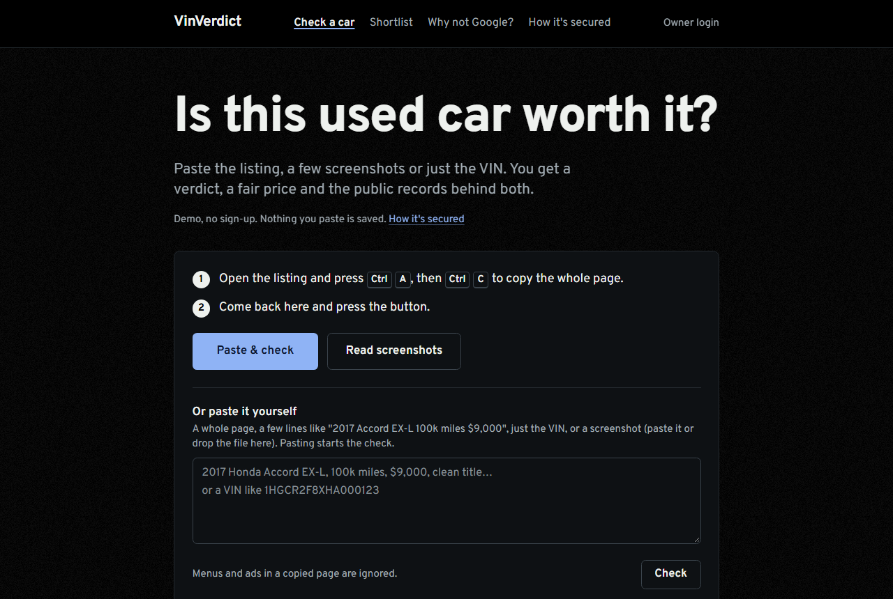
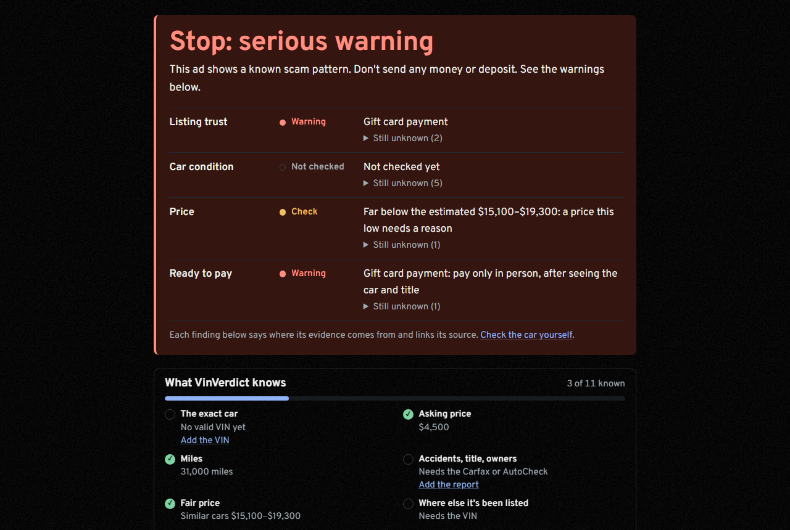
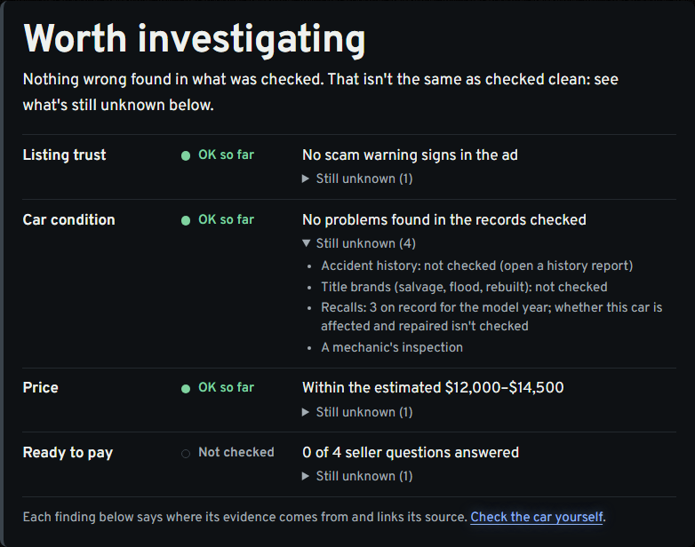
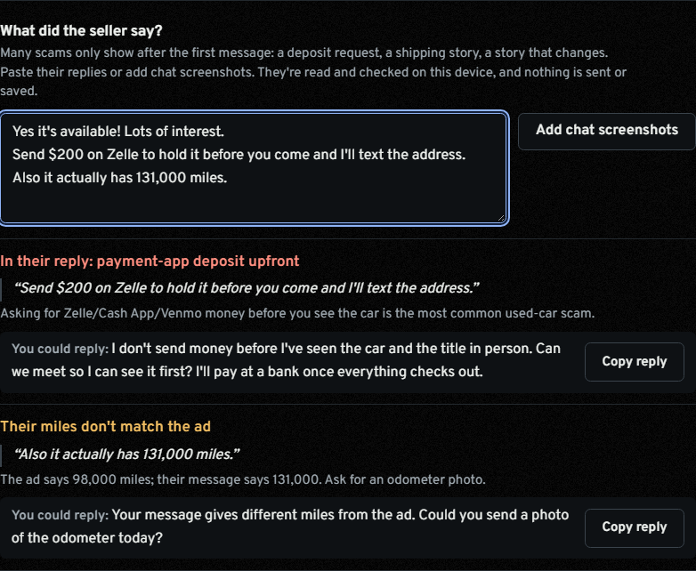
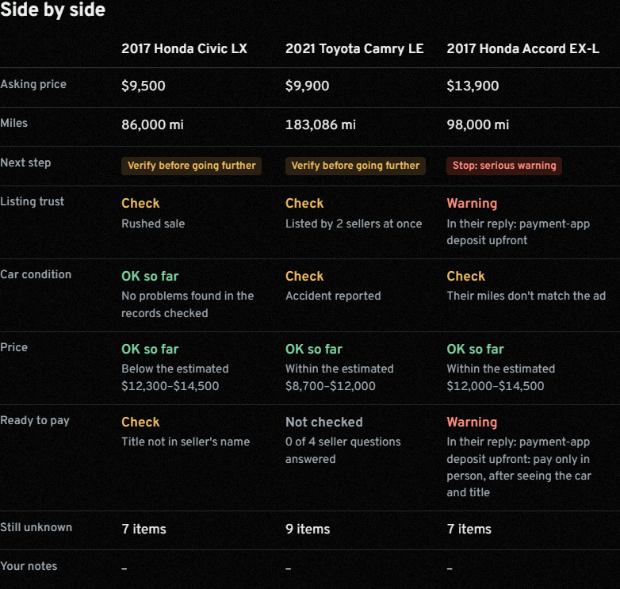
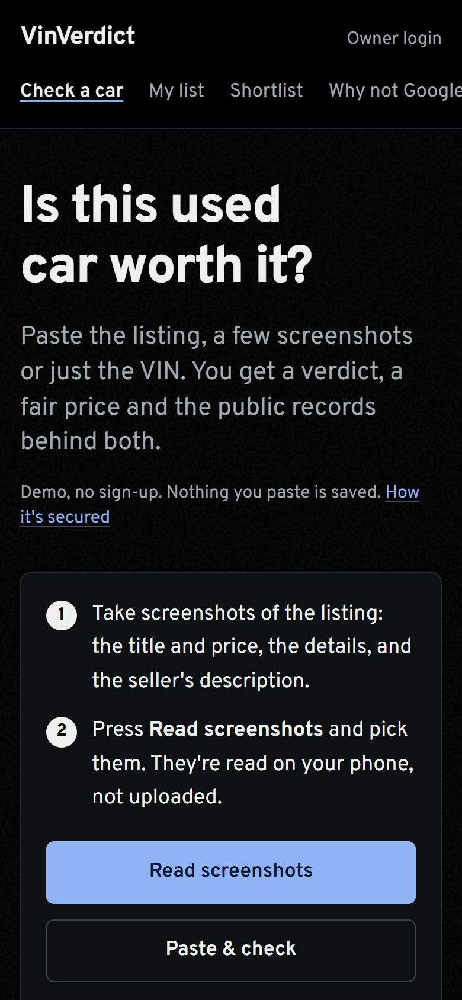
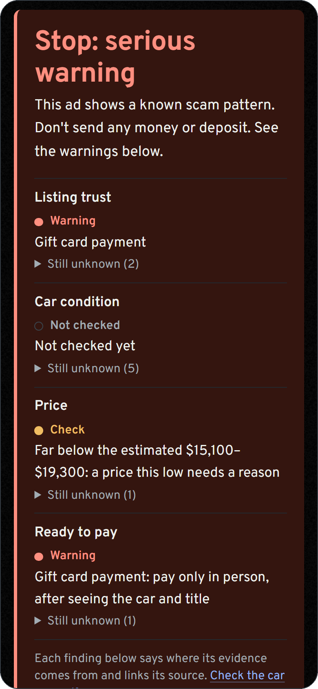
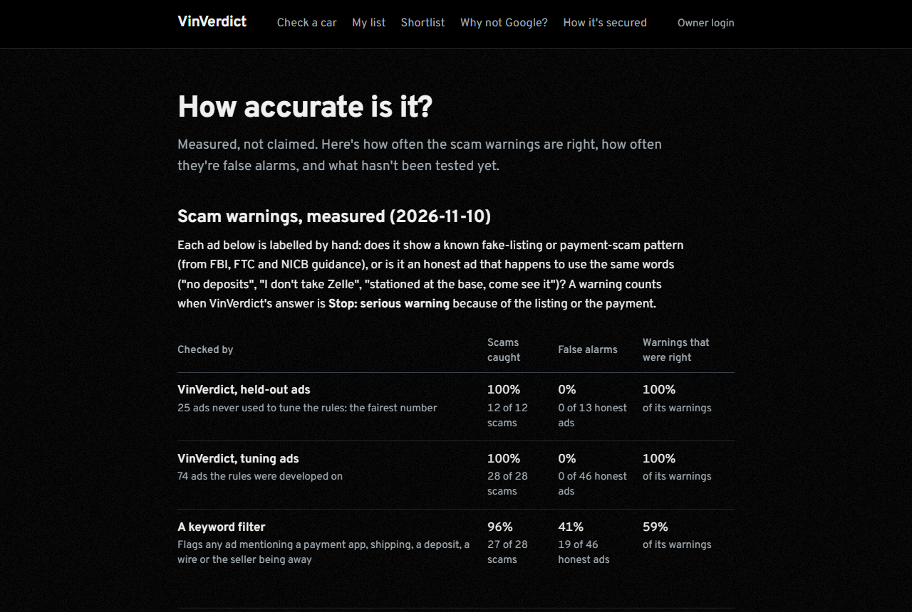
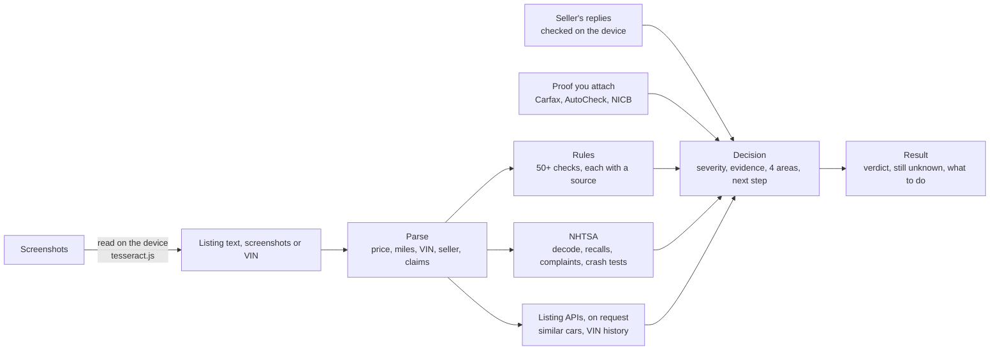

# VinVerdict

**A free second opinion before you buy a used car.** Paste a Facebook Marketplace, Craigslist or dealer listing (or just a VIN). VinVerdict tells you whether the ad shows scam warning signs, what the car is likely worth near you, what's known to go wrong with that model year, and exactly what to check next. Every fact links to the record it came from, and it never claims to know more than its evidence shows.

[](https://github.com/amoghnellutla/VinVerdict/actions/workflows/ci.yml)
[](https://github.com/amoghnellutla/VinVerdict/actions/workflows/codeql.yml)
[](LICENSE)

**Try it free, no sign-up: https://vinverdict.vercel.app**



---

## Contents

- [Why it exists](#why-it-exists)
- [What it does](#what-it-does)
- [How to use it](#how-to-use-it)
- [What it won't do](#what-it-wont-do)
- [Accuracy](#accuracy)
- [How it works](#how-it-works)
- [Security and privacy](#security-and-privacy)
- [Run it yourself](#run-it-yourself)
- [Help improve it](#help-improve-it)

---

## Why it exists

Used-car marketplaces are full of listings that look perfect: a clean car, a great price, a friendly story. Some are real bargains. Many are scams: the "deployed soldier" whose car is "with a shipping company", the deposit by Zelle "to hold it", the cloned dealer website. A low price alone can't tell you which is which, and no single search can either.

VinVerdict brings the separate checks a careful buyer would do into one place:
- read the ad;
- check the VIN against federal records;
- compare the price with similar cars;
- look up recalls and known problems;
- read the seller's replies for scam patterns;
- spell out what's still unknown.

It's built around one rule: **every warning answers three questions. What is the evidence? Does it apply to this car? What should you do next?**

## What it does

### 1. A clear next step, with the evidence behind it



Every check ends in one of four answers. It never says "safe":

| Answer | When |
| --- | --- |
| **Stop: serious warning** | A known scam pattern (gift cards, a deposit before viewing, a shipping-only story, a seller who's away) or a serious problem with the car (a branded title, an odometer rollback, miles the seller admits aren't real) |
| **Verify before going further** | Something to check with the seller or in person: a reported accident, a problem the seller admits (check engine light, transmission, won't start), a title not in the seller's name, a price far below similar cars |
| **Worth investigating** | Nothing wrong found in what was checked, with a list of what's still unknown |
| **Not enough information** | No VIN and no price to go on |

Behind it are four checks: **Listing trust, Car condition, Price, Ready to pay.** Each has a status (Warning, Check, OK so far, Not checked) and a "still unknown" list. Every finding says where its evidence comes from: *in the ad*, *official record*, *listing data*, *estimate*, *the seller's messages*, or *proof you attached*.

It reads private ads the way people write them: "Salvage? No. Flood: no. Accidents: none" counts as the seller saying no, not as a salvage title, and Craigslist's attribute box ("title status: rebuilt") is read field by field.



### 2. Checks the ad, the car and the seller

- **Scam patterns:** 50+ checks on the ad's words, each tied to FBI, FTC or NICB guidance, and context-aware. "Send $200 by Zelle to hold it" is a warning; "I don't take Zelle, cash in person" isn't. [Measured](#accuracy).
- **The VIN:** the federal check digit, then NHTSA's decoder, compared with the year, make, model and gearbox in the ad.
- **Where the car has been listed:** past listings of the VIN that MarketCheck recorded since 2015, with prices, miles and sellers. Flags odometer drops, quick resales and price cuts.
- **Recalls and known problems:**
  - NHTSA recalls, with "don't drive" and "park outside" warnings shown separately;
  - crash-test stars and owner complaints;
  - known issues, each backed by the maker's own service bulletin.
- **What the seller says:** paste the seller's replies or chat screenshots. They're read on your device and checked for deposit requests, shipping stories, refused inspections, and stories that change from the ad (miles, title, accidents). Each catch quotes the line and suggests a safe reply.



- **Proof you collect:** attach a Carfax, AutoCheck or NICB result (a screenshot or pasted text). VinVerdict reads it, files it under the right check, and updates the verdict. Bad news always wins.
- **Photos:** reverse-search the listing's photos (Google Lens, Bing) to see whether they appear in an older or faraway ad.
- **Fake dealer sites:** a short check based on the FTC's September 2026 alert on cloned dealer websites.
- **No listing yet?** [Used-car scam signs](https://vinverdict.vercel.app/scam-signs) explains the nine patterns it checks for, with an example, what to do and the official source for each.

### 3. Helps you decide and negotiate

- **Price:** an estimated range from the advertised prices of similar cars near your ZIP, listed now or recently ended. It's adjusted for miles, seller type and reported damage, and comes with an opening offer and a walk-away price. It's always labelled an estimate: what buyers finally paid isn't public. When the free lookups run out, **compare it yourself**: type a few similar asking prices and get an honest comparison.
- **What it'll cost:** out-the-door price with your state's tax and fees, plus fuel (EPA) and upkeep per year.
- **Before you buy:**
  - a ready-to-send message for the seller, with the model year's known issue by its bulletin number, and a photo check with a random phrase only someone holding the car can provide;
  - an inspection list for your mechanic;
  - buying-day steps.
- **My list:** save cars on your own device (no account) and compare them side by side, with notes. Export and import the list. It warns when two saved ads may be the same car.



### 4. AI mode (free AI, for everyone)

Three buttons on a result, using free AI services (GLM by Z.ai first, then Google's Gemini or Groq when it's busy), with no login needed:
- **Tell VinVerdict or ask:** one box for anything you know about the car. Paste the listing, a dealer-auction record or the Carfax, attach screenshots, or just say "it sold at auction for 9,100". VinVerdict works out what it is on your device, and **the whole result updates at once**: verdict, price, costs, questions and report. Each change shows as a chip you can undo.
  - Questions it can answer from the page ("is the price fair?", "what should I ask?", "what's next?") get an answer with buttons, without AI. The quick-start buttons fit the car: "What should I offer?" appears once a price is known, and the recall question names how many there are.
  - **"What should I offer?"** sets out the gap between the asking price and a dealer-auction sale, the price estimate (open at, walk away above), a cheaper listing of the same VIN and your leverage, then gives you a message to copy. Every number is one the page already has.
  - **Sections that change light up** for a moment (a steady outline with reduced motion), and the reply says what changed, out-the-door included.
  - **A ZIP you mention** ("my zip is 19103") becomes your ZIP for out-the-door, cost per year and the price check.
  - **Tell it what the seller said** ("he wants a deposit to hold it", "she'd take 13,500", "he won't let my mechanic inspect it"). It's checked like a pasted reply: a deposit request or a refused inspection turns the verdict to Stop at once, with a safe reply to copy. A new price or a doc fee updates the price and out-the-door sections.
  - **Scam-aware answers.** On an ad with scam signs, "what should I offer?" says don't, and "is this a scam?" lists what was found and how to pay safely. A price already below similar cars gets "find out why it's cheap", not a lower offer.
  - **More questions answered from the page:** who the seller is, common problems and reliability (NHTSA owner complaints and known issues for the year and engine), what to check when you go to see it, and short replies to "thanks" or "I bought it!".
  - **Paste or screenshot your chat with the seller** (Marketplace, texts, email). VinVerdict keeps only the seller's side (no buyer questions, app buttons, names or times) and checks it like a reply: a deposit request, a shipping story or "title's in the mail" turns the verdict at once.
  - **No price check left, or no VIN? Quote a price guide.** "KBB private party 12,500" or "Edmunds says 13,200" prices the car straight away, with no quota: the estimate, the offer and the walk-away price follow. It's always marked low confidence and "you quoted it". A private-party value is put on a dealer basis for a dealer's car, and a trade-in value is refused (it isn't a buying price).
  - **Got the VIN from the seller?** For an ad that had none, type it ("the VIN is …"): the same ad is checked again with it (exact model, recalls, title checks, the price check by VIN), keeping what you told it and the conversation. A mistyped VIN is caught by its check digit.
  - **A screenshot it can't place** never goes to the AI: if it's hard to read you get tips for a better one, and if it's unclear it shows what it read and asks "What is it?" (the seller's messages, a history report or the listing).
  - **"What does CR grade mean?"**, "what's a doc fee?", "what does as-is mean?": fixed definitions for 15 car-buying words, no AI.
  - **Ask several things at once** ("is the price fair and is it a scam?"): each gets its own answer.
  - **"Is 126k miles a lot?"** is answered from the page: miles a year against a typical car's 13,500 (FHWA), with what that means.
  - **The conversation is kept** on your device for that car (7 days), with what you told it.
  - **Follow-up questions** under each answer ("Next: What should I offer?"), never one you've already asked, and never the offer on a listing with serious warnings.
  - **No re-sending for visitors:** a question that needs the free AI (or a Carfax close read) is answered as soon as you tick "I'm human".
- **What VinVerdict knows:** a checklist under the verdict (the exact car, price, miles, accidents/title/owners, fair price, other listings, open recalls, the free NICB theft and total-loss check, the seller's answers, your mechanic's inspection), with "X of 10 known" and a button for each missing piece.
- **Miles agree across sources:** when the listing, an auction record and a Carfax or AutoCheck give the same odometer reading (within 3% or 1,000 miles), the result says so. That's real evidence against a rollback. The ad and its live feed count once.
  - Only open questions go to a free AI. Its answer comes from the report, each fact is tagged with its section, and an answer with a number or link that isn't in the report is thrown away.
- **Read it closely with free AI:** on a Carfax or AutoCheck you pasted or screenshotted, it lists every accident and damage event with its date, owners, use and service work.
  - Only events whose words are in your copy change the verdict.
  - Good news ("no accidents") needs your Confirm.
  - VinVerdict never opens Carfax itself (their terms forbid it).
- **Check the dealers now:** the server opens this car's own dealer links from its listing history (https only, never private addresses, robots.txt respected). It says whether each still lists the car, at what price and fees. The page's own listing data is read first; AI only fills the gaps.

Five AI actions per visitor per day, behind the "I'm human" check. Messages answered without AI don't count.

**It never costs money.** Every service runs on its free tier, and the code fails closed:
- a paid data lookup is refused if VinVerdict can't confirm it's inside the free quota;
- the AI calls only models priced free (a test enforces the list).

The account-side checklist is in [`workflows/no_charges.md`](workflows/no_charges.md). What's found goes into a separate "Found by AI" part of the report. The verdict itself stays rule-based.

### 5. Reference: every model's fuel cost by year

A side reference, linked from the footer rather than the menu, because it doesn't check a listing. [vinverdict.vercel.app/cars](https://vinverdict.vercel.app/cars) covers 86 makes and 988 models sold in the US from 2000 to 2026. Search by name or browse by make, then see each model year side by side:
- body type and size, engines, gas, hybrid or electric;
- the EPA's MPG and yearly fuel cost, also shown per month.

Every year links to the EPA's own page for that car. "Luxury brand" and "Sports car" labels appear only when the brand's or model's Wikipedia article says so in its opening, and the page quotes that sentence with the link. It goes back in the menu only once it helps judge a car: which years of a model had more recalls, owner complaints and lower crash ratings, from NHTSA.

## How to use it

**On a computer**
1. Open the listing (Facebook Marketplace, Craigslist, Autotrader, Cars.com, a dealer's site).
2. Press **Ctrl+A** then **Ctrl+C** (Mac: **Cmd+A**, **Cmd+C**) to copy the whole page.
3. Go to https://vinverdict.vercel.app, click the box, press **Ctrl+V**, then **Paste & check**.
4. Read the verdict, then work through the tabs: Price, Check it yourself, Photos, Safety, Costs, Before you buy.

Tip: drag the **bookmark button** on the home page to your bookmarks bar, then click it on any listing to send the page in one step.

**On a phone** (apps like Facebook have no "select all")
1. Screenshot the listing: the title and price, the details, and the seller's description.
2. On VinVerdict, tap **Read screenshots** and pick them. They're read on your phone, never uploaded.
3. On Android, you can also install VinVerdict (browser menu → Install, or Add to Home screen). It then appears in the **Share** menu for listings.

**Only have a VIN?** Paste the 17 characters. VinVerdict decodes it, finds where it's listed now and before, and prices it.

**Selling instead?** After a VIN lookup, choose **It's mine: what's it worth?**

**Want a second opinion from your own AI?** Under the verdict, open **Full report for you or your AI** (no login needed):
- Add the listing's link if you like. It's only written into the file; VinVerdict never opens it.
- Pick **Full** (everything on the page) or **Short** (the verdict, warnings, history, price, checks, safety and costs: about half the size, for chat boxes with a small limit).
- **Download report (.md)** or **Copy report**, then paste it into ChatGPT, Claude or any assistant and ask the questions at the end of the report.

The report is one Markdown file. It opens with:
- a short data header with the key facts (car, VIN, price, miles, verdict and its level, estimate, out-the-door total, how many steps are still open, full or short, format version) for AI tools to read exactly;
- an **At a glance** table;
- a **What's still open** checklist: price check, history report, outside checks, seller answers, their reply, inspection, listing link, ticked when done;
- how to read it: the four verdicts (and which one this car got, from fixed rules, not an AI), and what each evidence label means.

Then everything on the result page, in 14 numbered sections:
- the verdict and every warning with its evidence and source;
- the car and its VIN, part by part;
- the history report, the price and the listing history;
- **Check it yourself** with every link and what you attached;
- the photo check;
- recalls, crash stars and owner complaints with NHTSA numbers;
- out-the-door and yearly costs, using the state and fees you set on the page;
- buyer protection (for a maker-certified car, the warranty terms the ad lists and how many miles of cover could be left), and what to ask (seller questions, your message, their replies, the inspection list, buying day);
- sources, and questions to ask your AI.

At the end, the ad as you pasted it, with phone numbers and emails removed.

It's built on your device; nothing is sent. The seller's text is quoted in a block marked untrusted, with a note telling the AI never to follow instructions inside it, because a scam ad can hide instructions aimed at AI tools. Anything else that comes from outside (seller names, NHTSA complaint text, the seller's replies) is escaped, so it can't turn into a link or break a table. Out-the-door costs say when they used New Jersey only because no ZIP was entered.

<p>
  
  &nbsp;
  
</p>

## What it won't do

These limits are deliberate. A tool that sounds sure when it isn't does more harm than one that says "not checked".

- **It never says a car is safe.** The best answer is "worth investigating", with what's still unknown.
- **It never clears a car's history from listing data.** Feeds often miss accidents that Carfax or AutoCheck show, so a feed's "0 accidents" never counts as a clean history. Only a report you attach can.
- **Prices are estimates from advertised prices,** never presented as sale prices.
- **Recalls are for the model year.** Whether this car is affected or repaired is only in NHTSA's and the maker's VIN lookups, which are linked.
- **It doesn't replace a mechanic** or seeing the title in person.
- **It doesn't scrape Facebook or Craigslist,** and never fetches a link you paste. You choose what to share.

## Accuracy

**Measured, not claimed.** The full write-up, including what isn't tested yet, is at [How accurate is it?](https://vinverdict.vercel.app/accuracy)



**Scam warnings.** Every ad in [`src/lib/scam/eval/`](src/lib/scam/eval/) is labelled by hand. Some show a known scam pattern. The rest are honest ads that use the same words innocently: "no deposits", "I don't take Zelle", "I'm stationed at the base, come see it". A warning counts when VinVerdict says **Stop** because of the listing or the payment.

| Checked by | Scams caught | False alarms on honest ads | Warnings that were right |
| --- | --- | --- | --- |
| VinVerdict, **held-out ads** (never used to tune the rules) | 12 of 12 | 0 of 13 | 100% |
| VinVerdict, tuning ads | 38 of 38 | 0 of 56 | 100% |
| A keyword filter (payment app, shipping, deposit, away) | 33 of 38 | **26 of 56** | 56% |
| VinVerdict, **seller replies** (written before the first measurement) | 12 of 12 | 0 of 13 | 100% |
| The keyword filter, same replies | 10 of 12 | **7 of 13** | 59% |
| A **trained model** (naive Bayes), held-out ads | 12 of 12 | 0 of 13 | 100% |
| The trained model, tuning ads (leave-one-out) | 28 of 38 | 4 of 56 | 88% |

- **How it got there:** before context-aware rules, VinVerdict also caught every scam but told **9 of 46 honest ads (20%)** to stop. The first held-out run caught 11 of 12; the miss, a "refundable viewing fee" by Cash App, was fixed and moved into the tuning set, so the held-out number stays honest.
- **Rules or a trained model?** A naive Bayes model is retrained on the labelled ads on every change and scored next to the rules ([`learned.ts`](src/lib/scam/eval/learned.ts)). It changes no answer. On held-out ads both are perfect; scored leave-one-out on the tuning ads it misses 10 scams and flags 4 honest ads, and the real pages added so far each cost it catches. The words it leans on most ("to you", "it to", "the car") show it's learning the writing style of the test ads, not scam patterns. It would only join the app by beating the rules on real held-out listings, and then only to add warnings.
- **The caveat:** most ads so far are written from published scam patterns. Real listings are being added and reported separately, and real-world numbers will be lower.

**Listing parser.** Real page layouts (Facebook, Craigslist, Autotrader, Cars.com, CarGurus, CarMax, Carvana, dealer sites) are tested field by field in [`src/lib/listing/corpus/`](src/lib/listing/corpus/). Every listing it once got wrong is a case:

```
Listing corpus scorecard (32 cases)
  accident     23/23    make         27/27    price         32/32
  miles        29/29    model        27/27    titleStatus   19/19
  sellerType   23/23    transmission 17/17    verdict       26/26
  rules fired  34/34    false alarms avoided 145/145
  ownerCount   16/16    exteriorColor 13/13   usage          5/5
  kind         10/10    docFee        8/8     vin           14/14   distanceMiles 7/7
```

**The assistant's test set.** Every kind of message a buyer sends has to route correctly, or a test fails:
- 120 labelled messages: questions, facts, questions that look like facts, small talk and off-topic;
- all 33 real listing pages;
- report pages (Carfax, AutoCheck, NICB);
- auction records in Manheim, ADESA and ACV formats;
- links and bare VINs.

The test lives in [`src/lib/assistant/eval.test.ts`](src/lib/assistant/eval.test.ts). Every miss found in use is added to it. In a live run of 10 open questions through the free AI, 10 of 10 gave an answer that passed the checks (no invented numbers or links).

**The dataset.** Every labelled ad, pasted page and seller reply is in one file, [`dataset/vinverdict-labelled.jsonl`](dataset/) (about 140 rows, one JSON object per line, loadable with pandas), with a [description](dataset/README.md) of how it was labelled and its limits. A test fails if the file and the measurements drift apart. To grow it: `npm run add-case` adds a pasted listing (phone numbers and emails removed automatically), you fill in the right answers by hand, and `npm run retrain` retrains the model and refreshes the scorecard and the dataset.

**Sources.** Every known model-year problem cites the maker's bulletin it was checked against, and a test fails if a bulletin number or year range changes. The test was added after an outside review found the 2015–16 Accord/CR-V CVT warning citing the wrong bulletin.

All of this runs offline on every push ([CI](.github/workflows/ci.yml)). The published scorecard can't go stale: the build fails if it doesn't match the code.

## How it works



**Design decisions**

- **Rules make the calls, not a language model.** Every warning is a deterministic rule with a named source. The same listing always gets the same answer, it can be measured against labelled ads, and it costs nothing per check.
- **Evidence has a type.** A finding is labelled by where it came from: the ad, an official record, listing data, an estimate, the seller's messages, or the buyer's own proof. "No title issue in the records checked" is never shown as "title verified clean".
- **Listing feeds can only add bad news.** An accident, a price cut or an odometer drop from a feed adds a warning; a feed's "0 accidents" never removes one.
- **Each dealer's history is its own.** A price cut is one seller lowering its own price, days on sale run from the dealer selling it now, and when the same VIN is listed by another dealer (or the ad's dealer stopped listing it) the result says so first, with each dealer's dates and price. A feed's seller name that doesn't match its own link isn't trusted.
- **Private by default.** Screenshots, chat messages and My list stay on the visitor's device. The verdict is computed in the browser, so answering a question updates it instantly with no server call.
- **$0 to run.**
  - Free government data (NHTSA, FuelEconomy.gov), free-plan listing APIs and free hosting.
  - Paid lookups sit behind a button, are cached for a day and are counted.
  - Visitors get a daily ration, enforced in the database, and the owner keeps a monthly reserve.
  - When the free lookups run out, everything else still works, including the manual price comparison.

**Stack:** Next.js 16 (App Router, React 19, TypeScript, Tailwind CSS 4) on Vercel, Supabase (Postgres with row-level security, Auth with TOTP), Cloudflare Turnstile, tesseract.js, Vitest. More detail: [docs/ARCHITECTURE.md](docs/ARCHITECTURE.md). Scope and change log: [docs/PLAN.md](docs/PLAN.md).

## Security and privacy

- **Nothing kept from visitors.**
  - Checks aren't stored.
  - Screenshots and chat messages never leave the device.
  - Visitor IPs are kept only as a salted one-way hash for rate limits, for two days.
- **Hardened like a production app:**
  - a strict nonce-based Content-Security-Policy;
  - server-only API keys;
  - validation on every server action;
  - two-step login and row-level security for the owner's saved cars;
  - Cloudflare Turnstile and database-enforced limits on paid lookups.
- **Tested as an attacker would:**
  - script injection through listings, proof text, imported lists and URLs;
  - malicious image files (SVG with script, polyglot PNG, a decompression bomb);
  - CSRF;
  - login brute force;
  - simultaneous request bursts against the limits;
  - inputs built to freeze the parser.
- **Automated:** CodeQL scanning (0 open alerts), Dependabot and secret scanning with push protection.
- **Accessible:** axe-core's WCAG 2.2 AA rules report no violations on any public page or result state, on a computer and a phone (`security-tests/accessibility.py`).

The attacks are a rerunnable kit in [`security-tests/`](security-tests/). Threat model and OWASP ASVS 5.0 self-assessment, including known gaps: [SECURITY.md](SECURITY.md). Plain-English tour: [How it's secured](https://vinverdict.vercel.app/security). Found a problem? Please [report it privately](https://github.com/amoghnellutla/VinVerdict/security/advisories/new).

## Run it yourself

**You need:** Node.js 20.9 or newer (22 recommended) and a free Supabase project. Listing-API keys are only needed for the price and history lookups.

```bash
git clone https://github.com/amoghnellutla/VinVerdict.git
cd VinVerdict
npm install
cp .env.example .env.local     # then fill in what you have (see below)
npm run dev                    # http://localhost:3000
```

| Setting in `.env.local` | Needed for | Where to get it |
| --- | --- | --- |
| `NEXT_PUBLIC_SUPABASE_URL`, `NEXT_PUBLIC_SUPABASE_PUBLISHABLE_KEY` | Starting the app (owner login, saved cars, visitor limits) | [Supabase](https://supabase.com) free project → Project Settings → API |
| `MARKETCHECK_API_KEY` | Price check and listing history | [MarketCheck](https://www.marketcheck.com/apis) free plan |
| `AUTODEV_API_KEY` | Live listing lookup and photos | [Auto.dev](https://www.auto.dev/) free plan |
| `NEXT_PUBLIC_TURNSTILE_SITE_KEY`, `TURNSTILE_SECRET_KEY` | The "I'm human" check on public price lookups | [Cloudflare Turnstile](https://dash.cloudflare.com/sign-up) (free) |
| `GUEST_HASH_SALT` | Hashing visitor IPs for rate limits | Any 64 random hex characters |

Without the listing-API keys, everything except the price and history lookups still works. Step-by-step setup, including the database tables (`supabase/migrations/`, run once in the Supabase SQL editor), is in [docs/SETUP.md](docs/SETUP.md).

| Command | What it does |
| --- | --- |
| `npm run dev` | Local site with hot reload |
| `npm test` | All tests, offline, with the parser and scam scorecards (no API calls) |
| `npm run add-case -- --name <name> --label scam\|honest --file listing.txt` | Add a pasted listing to the labelled dataset (removes phone numbers and emails) |
| `.venv\Scripts\python -I tools/build_cars.py download epa labels merge` | Rebuild the Car guide data from EPA and Wikipedia (free; see `workflows/build_cars.md`) |
| `npm run retrain` | Retrain the model, refresh the published scorecard and the dataset file, run every test |
| `npm run lint` / `npx tsc --noEmit` | Lint / type-check |
| `npm run build` then `npm start` | Production build, run locally |

**Project layout**

```
src/app/            pages (home, My list, scam signs, accuracy, shortlist, security, owner pages) and server actions
src/components/     the result page and shared UI
src/lib/decision.ts the buyer's decision: severity, evidence, four areas, next step
src/lib/scam/       warning-sign rules, and eval/ (labelled ads, scorecard, trained model)
dataset/            the labelled dataset as one JSONL file, with its description
src/data/catalog/   the Car guide data (built by tools/build_cars.py)
src/lib/listing/    listing parser and its accuracy corpus
src/lib/value/      price estimate and the manual comparison
src/lib/nhtsa/      NHTSA client and parsing
src/lib/evidence/   reading attached Carfax / AutoCheck / NICB proof
src/lib/workspace/  My list (device storage, validated import/export)
supabase/           database tables and limits (SQL, row-level security on every table)
tools/              Python scripts for data refreshes (e.g. the Shortlist from NHTSA)
security-tests/     attack kit for a local build (server functions, malicious files, injection, load)
```

## Help improve it

**Suggestions are very welcome.** The most useful thing you can send is a listing VinVerdict got wrong.

- **[It got a listing wrong](https://github.com/amoghnellutla/VinVerdict/issues/new?template=wrong-answer.yml)**: a wrong price, miles or year, a missed scam sign, or a false alarm. Paste the listing with phone numbers and names removed. It becomes a test case, so the mistake can't come back.
- **[Suggest an improvement](https://github.com/amoghnellutla/VinVerdict/issues/new?template=idea.yml)**: a check it should do, something confusing, or a free official data source it should use.
- **Pull requests:**
  - Open an issue first for anything big.
  - Keep `npm test` and `npm run lint` green.
  - Add a corpus or scam case for a rule or parser fix.
  - Link a source for any new fact: every fact on a result must link to where it came from.

## License

[MIT](LICENSE): free to use, copy and change, as long as the copyright notice stays. Data from NHTSA, FuelEconomy.gov, MarketCheck and Auto.dev stays under its providers' own terms.

---

VinVerdict is an independent project, not affiliated with NHTSA, the FBI, the FTC, NICB, Carfax, AutoCheck, MarketCheck, Auto.dev or any carmaker. It gives information, not legal or financial advice. Always see the car, the title and the seller in person, and have an independent mechanic inspect it before you pay.
