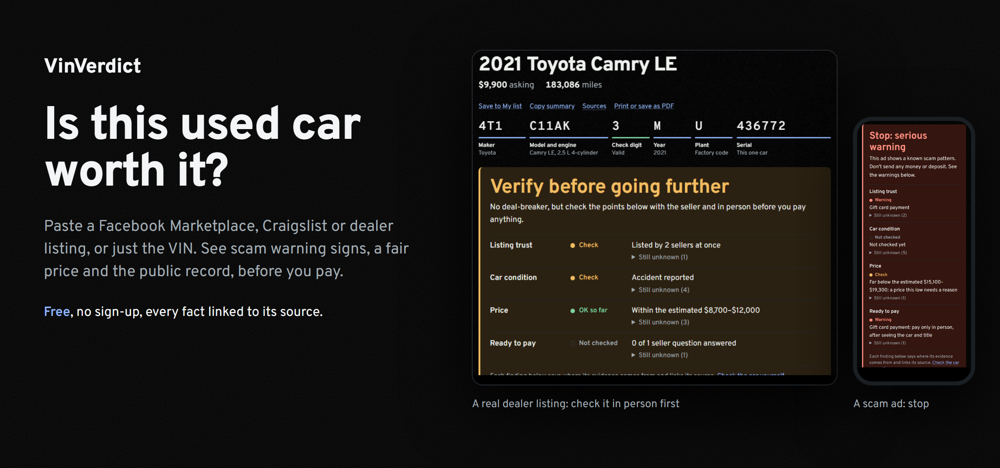
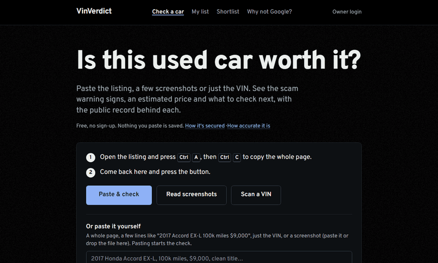
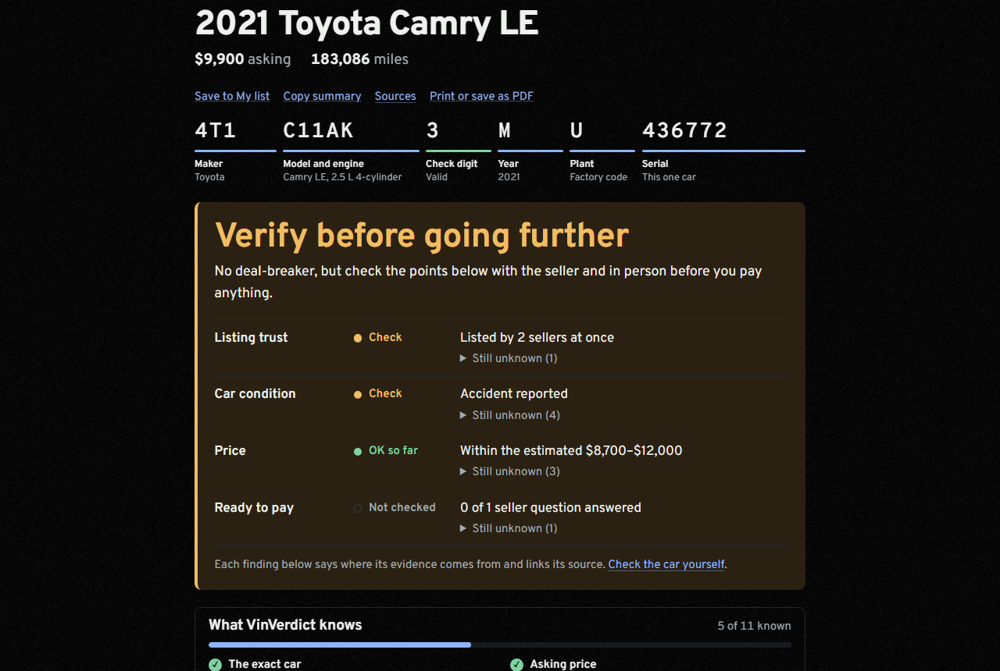
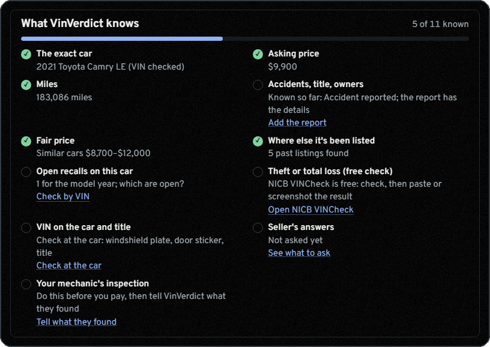
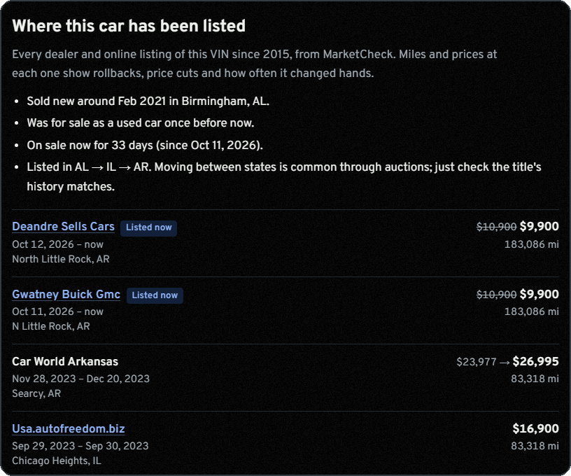
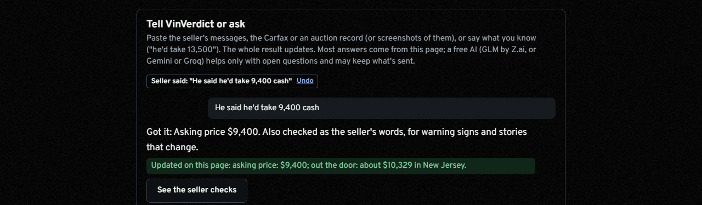
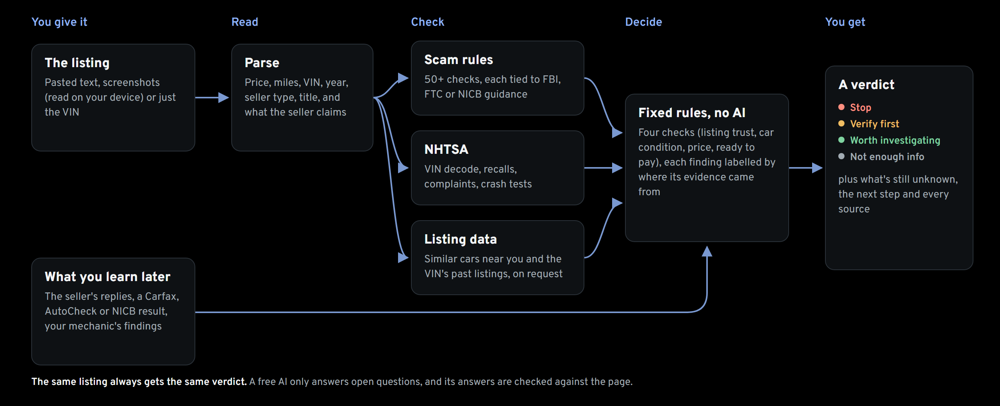

<p align="center">
  <a href="https://vinverdict.vercel.app"></a>
</p>

<p align="center">
  <b>VinVerdict is a free used car checker for US buyers.</b><br>
  Paste a listing from Facebook Marketplace, Craigslist, Autotrader, Cars.com or a dealer's site, a few screenshots, or just the VIN.<br>
  See scam warning signs, a fair price, the car's past listings and recalls, and what to check next. Every fact links to its source.
</p>

<p align="center">
  <a href="https://vinverdict.vercel.app"><b>Check a car free</b></a>
  &nbsp;&nbsp;|&nbsp;&nbsp;
  <a href="https://vinverdict.vercel.app/scam-signs">Used-car scam signs</a>
  &nbsp;&nbsp;|&nbsp;&nbsp;
  <a href="https://vinverdict.vercel.app/accuracy">How accurate is it?</a>
  &nbsp;&nbsp;|&nbsp;&nbsp;
  <a href="#run-it-yourself">Run it yourself</a>
</p>

<p align="center">
  <a href="https://github.com/amoghnellutla/VinVerdict/actions/workflows/ci.yml"></a>
  <a href="https://github.com/amoghnellutla/VinVerdict/actions/workflows/codeql.yml"></a>
  <a href="LICENSE"></a>
  
</p>

## See it work

<p align="center">
  
</p>

<p align="center"><sub>Recorded on the live site with the built-in examples: a real Camry dealer listing, then a typical Facebook scam ad.</sub></p>

## Why VinVerdict

**Facts about this exact car.** The VIN is decoded by NHTSA and compared with the ad. Every past listing of the VIN shows who sold it, when, for how much and at what miles. Recalls and owner complaints come for its model year.

**Rules you can check, not a guess.** The same listing always gets the same answer, from more than 50 checks tied to FBI, FTC and NICB guidance. In the [test set](#accuracy-measured-not-claimed) it caught 50 of 50 scam ads with 0 false alarms on 71 honest ones.

**Free and private.** No sign-up. Screenshots are read on your phone, nothing you paste is saved, and the code refuses anything that would cost money. It never says a car is "safe"; it says what's still unknown.

## What it checks

Each answer names its source and links the code or test behind it.

| Question | What you see |
| --- | --- |
| **Is this ad a scam?** | Deposits before viewing, gift cards, wire transfers, "the car is with a shipping company", a seller who's away, title washing, a price too good to be true. Context-aware: "send $200 by Zelle to hold it" is a warning, "I don't take Zelle, cash in person" isn't.<br><sub>FBI, FTC and NICB guidance ([each sign](https://vinverdict.vercel.app/scam-signs)) · [`rules.ts`](src/lib/scam/rules.ts), [tests](src/lib/scam/rules.test.ts)</sub> |
| **Is the VIN real, and is it this car?** | The check digit, then year, make, model and engine compared with the ad. A typo like the letter O for zero is caught and corrected.<br><sub>NHTSA vPIC · [`vin.ts`](src/lib/vin.ts), [tests](src/lib/vin.test.ts)</sub> |
| **What is it worth?** | A fair-price range for your ZIP, adjusted for miles, seller type and damage, with an opening offer and a walk-away price. Always labelled an estimate.<br><sub>Similar cars listed near you (MarketCheck) · [`value/`](src/lib/value/)</sub> |
| **Where has it been before?** | Every listing of the VIN since 2015 with dealer, dates, prices and miles. Flags odometer drops, price cuts, quick resales and two sellers at once.<br><sub>MarketCheck, Auto.dev · [`history/`](src/lib/history/)</sub> |
| **Recalls and safety** | Model-year recalls ("don't drive" and "park outside" marked), crash-test stars, owner complaints, and a link to check this VIN's open recalls.<br><sub>NHTSA · [`nhtsa/`](src/lib/nhtsa/)</sub> |
| **Known problems** | A short, hand-checked list for popular Honda and Toyota years, each citing the maker's own service bulletin.<br><sub>Bulletins on nhtsa.gov · [`inspection.ts`](src/lib/inspection.ts)</sub> |
| **The real total** | Out-the-door price with your state's tax and fees, plus fuel and upkeep per year.<br><sub>State tax tables, EPA · [`costs/`](src/lib/costs/)</sub> |
| **Is the seller's story changing?** | Paste their replies or chat screenshots: deposit requests, shipping stories, refused inspections and changed miles, title or accident claims, each with a safe reply to copy.<br><sub>Read on your device · [`seller-replies.ts`](src/lib/seller-replies.ts), [tests](src/lib/seller-replies.test.ts)</sub> |
| **Are the photos really this car?** | One-tap reverse image search to find them in an older or faraway ad.<br><sub>Google Lens, Bing · [`PhotoCheck.tsx`](src/components/analyzer/PhotoCheck.tsx)</sub> |
| **Stolen or a total loss?** | The free NICB VINCheck, one click away. Its result counts as proof once you paste it.<br><sub>NICB · [`evidence/`](src/lib/evidence/)</sub> |

## A closer look

<table>
<tr>
<td width="50%"></td>
<td width="50%" valign="middle">

### One clear answer, never "safe"

Every check ends in one of four answers, from fixed rules ([`decision.ts`](src/lib/decision.ts)), not an AI:

- **Stop:** a known scam pattern or a serious problem (branded title, odometer rollback, VIN mismatch)
- **Verify before going further:** something to check with the seller or in person
- **Worth investigating:** nothing wrong found, with what's still unknown
- **Not enough information:** no VIN and no price

Every finding says where its evidence came from: *in the ad*, *official record*, *listing data*, *estimate*, *the seller's messages* or *proof you attached*.

</td>
</tr>
<tr>
<td width="50%" valign="middle">

### What's known, and what's missing

A checklist shows how much is known about the car, with a button for each missing piece: the history report, the free NICB check, the seller's answers, your mechanic's inspection.

</td>
<td width="50%"></td>
</tr>
<tr>
<td width="50%"></td>
<td width="50%" valign="middle">

### A fair price and what to offer

A range from similar cars near your ZIP, an opening offer, a walk-away price, and the reasons to give the seller (a past accident, fleet use, an earlier price cut, high miles).

</td>
</tr>
<tr>
<td width="50%" valign="middle">

### Every past listing of the VIN

Who sold it, when, at what price and with how many miles. Here the same Camry is listed by two dealers at once after a $1,000 cut, and its miles went from 83,318 to 183,086.

</td>
<td width="50%"></td>
</tr>
<tr>
<td width="50%"></td>
<td width="50%" valign="middle">

### Tell it what you learn

Type what the seller said, or paste their messages or a Carfax, and the whole result updates, with Undo. A new price changes the offer and the total; a deposit request turns the verdict to Stop. Questions like "what should I offer?" are answered from the page. Only open questions use a free AI, and an answer with a number or link that isn't on the page is thrown away ([`guard.ts`](src/lib/ai/guard.ts)).

</td>
</tr>
<tr>
<td width="50%" valign="middle">

### Made for the phone, too

Screenshot a listing and tap **Read screenshots**: the text is read on your phone ([tesseract.js](https://github.com/naptha/tesseract.js)), and the images never leave it. At the car, **Scan a VIN** reads the door-sticker barcode, and **At the car** checks that the windshield plate, door sticker and title all match the ad.

</td>
<td width="50%" align="center">&nbsp;</td>
</tr>
</table>

**Also on a result:** a ready-to-send message for the seller, an inspection list for your mechanic, buying-day steps, a full report to download (Markdown) or print (PDF), and **My list** to save and compare cars on your device. Selling your own car? Switch to **It's mine** for its value, a draft ad and checks on buyers' messages for overpayment and fake-shipper scams.

## Honest by design

> [!IMPORTANT]
> A tool that sounds sure when it isn't does more harm than one that says "not checked". So VinVerdict:
> - **never says a car is safe.** The best answer is "worth investigating", with what's still unknown;
> - **never clears a car's history from listing data.** A feed's "0 accidents" never counts as a clean history ([`history-report.ts`](src/lib/history-report.ts)); only a report you attach can;
> - **labels prices as estimates** from advertised prices, never as what buyers paid;
> - **doesn't replace a mechanic** or seeing the title in person;
> - **doesn't scrape Facebook or Craigslist** and never opens a link you paste.

## Accuracy: measured, not claimed

Every ad below is labelled by hand as a scam or as an honest ad that uses the same words innocently ("no deposits", "I don't take Zelle", "I'm stationed at the base, come see it"). A warning counts when VinVerdict says **Stop**. The numbers come from [`scorecard.json`](src/lib/scam/eval/scorecard.json), which the tests regenerate on every push; the [accuracy page](https://vinverdict.vercel.app/accuracy) has the full write-up.

| Checked by | Scams caught | False alarms on honest ads | Warnings that were right |
| --- | :-: | :-: | :-: |
| VinVerdict, **held-out ads** (never used to tune the rules) | 12 / 12 | 0 / 13 | 100% |
| VinVerdict, tuning ads | 38 / 38 | 0 / 58 | 100% |
| A keyword filter (payment app, shipping, deposit, away) | 33 / 38 | **28 / 58** | 54% |
| VinVerdict, **seller replies** | 12 / 12 | 0 / 13 | 100% |
| The keyword filter, same replies | 10 / 12 | **7 / 13** | 59% |

A keyword filter catches most scams but warns on half the honest ads. VinVerdict reads the context ("I *don't* take Zelle"), which is where those false alarms go.

> [!NOTE]
> Most test ads are written from published scam patterns. The real listings collected so far are all honest, and none got a false alarm. Real-world numbers will be lower, and they're reported separately as real listings are added. A trained model (naive Bayes) is scored next to the rules on every change ([`learned.ts`](src/lib/scam/eval/learned.ts)); it misses 12 of the 38 tuning scams, so it changes no answer.

**Listing parser:** 33 real listing pages (Facebook, Craigslist, Autotrader, Cars.com, CarGurus, CarMax, Carvana, dealer sites) are tested field by field in [`listing/corpus/`](src/lib/listing/corpus/). Every listing it once got wrong became a test case. From the `npm test` output:

```
Listing corpus scorecard (33 cases)
  price        33/33    miles        30/30    year         29/29
  make         28/28    model        28/28    vin          15/15
  accident     24/24    titleStatus  20/20    sellerType   24/24
  transmission 18/18    ownerCount   17/17    verdict      27/27
  rules fired  38/38    false alarms avoided  165/165
```

**The assistant:** 170+ labelled messages and every real listing page must route correctly ([`eval.test.ts`](src/lib/assistant/eval.test.ts)). **The dataset:** all 149 labelled rows are in [`dataset/vinverdict-labelled.jsonl`](dataset/), with a [description](dataset/README.md) of how they were labelled.

## Free, private and secure

| Promise | How it's kept |
| --- | --- |
| **Never costs money** | A paid lookup is refused unless the meter confirms it's inside the free quota ([`usage.ts`](src/lib/usage.ts)). The AI calls only models on a free list, and a test fails otherwise ([`providers.ts`](src/lib/ai/providers.ts)). Visitors get a daily allowance enforced in the database, behind Cloudflare's "I'm human" check. |
| **Private by default** | Visitors' checks aren't stored. Screenshots, chat messages and My list stay on the device. Visitor IPs are kept only as a salted one-way hash, for rate limits. |
| **Secured** | A strict nonce-based Content-Security-Policy ([`csp.ts`](src/lib/csp.ts)), API keys only on the server, input validation on every server action, two-step login and row-level security on every table. |
| **Attacked on purpose** | A rerunnable kit in [`security-tests/`](security-tests/): script injection, malicious image files, CSRF, login brute force, request bursts and inputs built to freeze the parser. CodeQL, Dependabot and secret scanning run on the repo. Threat model and OWASP ASVS 5.0 self-assessment: [SECURITY.md](SECURITY.md). |

## How it works

<p align="center">
  
</p>

**Why rules and not a chatbot?** A chatbot asked "is this a scam?" can answer differently each time, rarely shows its evidence and can't be measured. Every VinVerdict warning is a deterministic rule with a named source, so it's repeatable, scored against labelled ads and free to run. AI is used only where it helps (open questions, reading a pasted history report), and its output is checked against the page.

**Stack:** Next.js 16 (App Router, React 19, TypeScript, Tailwind CSS 4) on Vercel, Supabase (Postgres with row-level security, Auth with TOTP), Cloudflare Turnstile, tesseract.js and Vitest. Details: [ARCHITECTURE.md](docs/ARCHITECTURE.md). Scope and change log: [PLAN.md](docs/PLAN.md).

## Run it yourself

You need Node.js 20.9+ (22 recommended) and a free [Supabase](https://supabase.com) project.

```bash
git clone https://github.com/amoghnellutla/VinVerdict.git
cd VinVerdict
npm install
cp .env.example .env.local     # fill in what you have (see below)
npm run dev                    # http://localhost:3000
```

<details>
<summary><b>Settings and commands</b></summary>

| Setting in `.env.local` | Needed for | Where to get it |
| --- | --- | --- |
| `NEXT_PUBLIC_SUPABASE_URL`, `NEXT_PUBLIC_SUPABASE_PUBLISHABLE_KEY` | Starting the app (saved cars, visitor limits) | [Supabase](https://supabase.com) free project |
| `MARKETCHECK_API_KEY` | Price check and listing history | [MarketCheck](https://www.marketcheck.com/apis) free plan |
| `AUTODEV_API_KEY` | Live listing lookup and photos | [Auto.dev](https://www.auto.dev/) free plan |
| `NEXT_PUBLIC_TURNSTILE_SITE_KEY`, `TURNSTILE_SECRET_KEY` | The "I'm human" check | [Cloudflare Turnstile](https://dash.cloudflare.com/sign-up) (free) |
| `GUEST_HASH_SALT` | Hashing visitor IPs for rate limits | Any 64 random hex characters |

Without the listing-API keys, everything except the price and history lookups still works. Step-by-step setup, including the database tables: [docs/SETUP.md](docs/SETUP.md).

| Command | What it does |
| --- | --- |
| `npm run dev` | Local site with hot reload |
| `npm test` | All tests, offline, with the parser and scam scorecards |
| `npm run lint` / `npx tsc --noEmit` | Lint / type-check |
| `npm run build` then `npm start` | Production build, run locally |
| `npm run add-case -- --name <name> --label scam\|honest --file listing.txt` | Add a listing to the labelled dataset (phone numbers and emails removed) |
| `npm run retrain` | Retrain the model, refresh the scorecard and the dataset, run every test |

</details>

## Help improve it

The most useful thing you can send is a listing VinVerdict got wrong.

- **[It got a listing wrong](https://github.com/amoghnellutla/VinVerdict/issues/new?template=wrong-answer.yml):** a wrong price, miles or year, a missed scam sign or a false alarm. It becomes a test case, so the mistake can't come back.
- **[Suggest an improvement](https://github.com/amoghnellutla/VinVerdict/issues/new?template=idea.yml):** a check it should do, something confusing, or a free official data source it should use.
- **Pull requests:** open an issue first for anything big, keep `npm test` and `npm run lint` green, add a test case for a rule or parser fix, and link a source for any new fact.
- **Security problem?** Please [report it privately](https://github.com/amoghnellutla/VinVerdict/security/advisories/new).

## License

[MIT](LICENSE). Data from NHTSA, FuelEconomy.gov, MarketCheck and Auto.dev stays under its providers' own terms.

<sub>VinVerdict is an independent project, not affiliated with NHTSA, the FBI, the FTC, NICB, Carfax, AutoCheck, MarketCheck, Auto.dev or any carmaker. It gives information, not legal or financial advice. Always see the car, the title and the seller in person, and have an independent mechanic inspect it before you pay.</sub>
